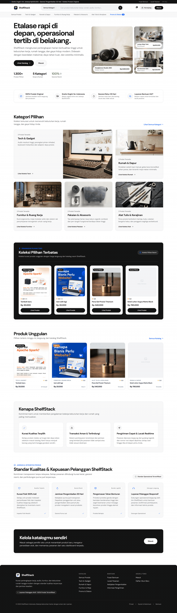

# ShelfStack, Mini E-Commerce Fullstack

Aplikasi mini e-commerce fullstack: storefront publik + cart dan checkout + admin dashboard + auth dengan role. Dibangun dengan Nuxt 4 dan Supabase sebagai fondasi data, auth, storage, dan realtime.

Status rilis: `v0.15.0` (lihat `version.json`). Status pengerjaan terkini ada di `docs/PROGRESS.md`, scope di `docs/BACKLOG.md`, indeks dokumen di `docs/README.md`.

## Demo

Belum ada demo publik, jalankan lokal untuk mencoba.



Alur yang terlihat di GIF: storefront, katalog, detail produk, cart, checkout, riwayat order, dan dashboard admin.

## Fitur

| Storefront                                                                                                                                            | Cart dan Orders                                                                                                                                                                                            | Admin                                                                                                                                                                                                                                                                        |
| ----------------------------------------------------------------------------------------------------------------------------------------------------- | ---------------------------------------------------------------------------------------------------------------------------------------------------------------------------------------------------------- | ---------------------------------------------------------------------------------------------------------------------------------------------------------------------------------------------------------------------------------------------------------------------------- |
| Search, filter kategori, dan sort tersinkron di URL, halaman detail SEO dengan Open Graph dan breadcrumb, badge stok (`Habis`, `Sisa <5`, `Tersedia`) | Cart persisten di `localStorage`, checkout dengan alamat tervalidasi Zod, total anti tamper dihitung server via RPC `create_order`, bayar via Midtrans Sandbox (Snap), riwayat dan tracking order realtime | KPI dashboard (revenue, order pending, low-stock, customers), manajemen status order hanya via transisi legal (`transition_order_status`), CRUD produk dan kategori, ledger stok `stock_movements`, audit `activity_logs`, export CSV order dengan filter tanggal dan status |

Catatan keamanan: total order, stok, status pembayaran, dan role tidak pernah dipercayakan ke client. PostgreSQL adalah sumber kebenaran untuk inventory, state order, dan state payment. RLS ketat di tabel `products`, `orders`, `order_items`, `profiles`, `activity_logs` dan bucket `product-images`.

## Arsitektur

Alur singkat: Postgres dengan RLS, Nuxt server (validasi Zod + RPC), Pinia store, UI PrimeVue dan Tailwind, Supabase Realtime untuk update status order, deploy via Docker dan Nginx.

Diagram lengkap (mermaid): [docs/architecture/overview.md](docs/architecture/overview.md)

Pola kode mengikuti FSD-lite: halaman di `app/pages/` hanya orkestrasi, logika fitur tinggal di `app/features/<nama-fitur>/`, komponen global terstandarisasi (`UiButton`, `UiInput`, `UiBadge`, `UiCard`). Detail pola ada di `docs/ARCHITECTURE.md`.

Pilot service: `services/order-service` (Fastify + Redis) berjalan sebagai pilot di samping API Nitro utama. BullMQ belum diimplementasi, TODO.

## Tech Decision

- Nuxt 4 + Supabase sebagai satu backend utama (Postgres, Auth, Storage, Realtime), RPC `create_order` untuk checkout atomik dengan row lock. Lihat [ADR-001](docs/ADR/001-nuxt-supabase.md) dan [ADR-003](docs/ADR/003-price-cents-rpc.md).
- FSD-lite untuk isolasi fitur agar halaman tetap tipis dan modul mudah dicabut atau diuji terpisah. Lihat [ADR-002](docs/ADR/002-fsd-lite.md).
- Satu project Supabase untuk semua environment kerja saat ini agar RLS, migrasi, dan seed konsisten. Lihat [ADR-004](docs/ADR/004-single-supabase-project.md).
- Payment memakai Midtrans Sandbox langsung, tidak ada lapisan mock di kode. Webhook verifikasi signature SHA-512, idempotent, dan aman terhadap duplikat serta race cancel atau expiry.

## Cara Run 5 Menit

Prasyarat: Node 22, pnpm, dan project Supabase (lokal atau cloud).

1. Clone repo, lalu copy env:

   ```bash
   cp .env.example .env
   ```

   Isi kredensial Supabase dan Midtrans Sandbox di `.env` (lihat `.env.example`).

2. Install dan jalankan:

   ```bash
   pnpm install
   pnpm dev
   ```

   Buka `http://localhost:3000`.

3. Untuk data awal: `supabase db reset` menghasilkan kategori kanonik, produk kurasi, dan user seed lokal. Seed lokal `.local` hanya untuk Supabase lokal.

Build dan preview produksi lokal:

```bash
pnpm build
pnpm preview
```

Deploy target adalah Docker + Nginx (`Dockerfile`, `deploy/docker-compose.prod.yml`, `deploy/nginx/nginx.conf`), bukan platform hosting statis.

## Test dan CI

Perintah yang tersedia (pnpm saja):

- `pnpm dev`, jalankan server dev lokal
- `pnpm build`, build produksi
- `pnpm preview`, preview hasil build lokal
- `pnpm typecheck`, cek tipe via `nuxi typecheck`
- `pnpm lint` dan `pnpm lint:fix`, ESLint
- `pnpm test`, unit test Vitest (watch mode)
- `pnpm test:e2e`, E2E Playwright (`tests/e2e/`)

Kondisi suite: unit Vitest dan E2E Playwright mencakup critical path `register, checkout, admin approval` plus audit trail. Angka jumlah test tidak ditulis di sini agar tidak basi, jalankan suite untuk angka terkini.

CI (`.github/workflows/ci.yml`): job quality (`lint`, typecheck root + order-service, `build`), job test (Vitest root + order-service), validasi `docker compose config`, lalu suite E2E Playwright. CI berjalan di setiap push dan PR ke `main`, `develop`, `feat/**`, `fix/**`.

## Akun Demo

Tanpa password di repo ini. Akun demo dibuat via dashboard Supabase (dok internal). Seed lokal `.local` hanya untuk Supabase lokal, bukan untuk environment cloud. Kredensial E2E dibaca dari env (`E2E_CUSTOMER_EMAIL`, `E2E_ADMIN_EMAIL`, dan pasangannya), di CI via GitHub Secrets.

## Sisa dan TODO

- BullMQ belum diimplementasi (order-expiry masih direct sweep, tanpa queue atau DLQ), TODO.
- Skor Lighthouse belum diukur, jangan jadikan klaim. TODO ukur perf dan a11y mobile sebelum klaim apa pun.

## Docs Terkait

- `docs/README.md`, indeks dokumentasi
- `docs/PROGRESS.md`, status terkini dan Known Gaps (wajib dibaca sebelum kerja)
- `docs/BACKLOG.md`, scope dan acceptance criteria (ID Q-04 adalah task packaging ini)
- `docs/ARCHITECTURE.md`, pola FSD-lite
- `docs/ADR/`, keputusan arsitektur
- `docs/PORTFOLIO-PACKAGING.md`, template packaging (sebagian isinya basi, fakta yang benar ikut README ini dan `docs/PROGRESS.md`)
