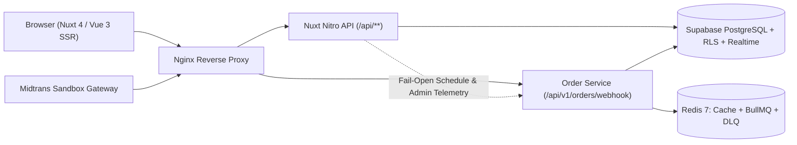

# ShelfStack

[](https://github.com/arzss-code/shelfstack/actions/workflows/ci.yml)
[](https://nuxt.com)
[](https://www.typescriptlang.org)
[](https://supabase.com)
[](https://bullmq.io)
[-6E9F18?logo=vitest&logoColor=white>)](https://vitest.dev)

Aplikasi e-commerce berbasis **Nuxt 4**, **Nitro**, **Supabase (PostgreSQL, Auth, Storage, Realtime)**, **Midtrans Sandbox**, dan worker mikroservis **Fastify + Redis 7 + BullMQ** (`@shelfstack/order-service`).

Proyek ini dibangun untuk mendemonstrasikan praktik rekayasa perangkat lunak production-grade: integritas transaksional atomik di level basis data, pemisahan mutlak status pesanan dan pembayaran via finite state machine, antrean asinkron toleran kegagalan (delayed queue + DLQ), pengujian beban empiris terautentikasi (k6), serta arsitektur komponen modular (maksimal 300 baris per berkas).

> Dokumentasi rujukan: [docs/README.md](docs/README.md), [docs/PROGRESS.md](docs/PROGRESS.md), [docs/BACKLOG.md](docs/BACKLOG.md), dan [DESIGN.md](DESIGN.md).

---

## Arsitektur Sistem

Topologi sistem memisahkan layanan web storefront/API gateway dengan worker pemroses antrean latar belakang:



---

## Sorotan Rekayasa Perangkat Lunak

1. **Integritas Transaksional PostgreSQL (Anti-Overselling)**:
   Seluruh mutasi stok, alokasi voucher kupon, dan saldo koin loyalitas dieksekusi atomik di dalam fungsi PL/pgSQL `create_order` dengan penguncian baris deterministik (`ORDER BY id FOR UPDATE`). Tidak ada harga, stok, atau diskon yang dipercayakan dari input klien.
2. **Pemisahan State Machine Pesanan & Pembayaran**:
   Status pesanan (`pending`, `paid`, `processing`, `shipped`, `completed`, `cancelled`) dan status pembayaran (`unpaid`, `pending`, `paid`, `failed`, `refunded`) dikelola terpisah. Trigger basis data `enforce_order_status_state_machine` memblokir transisi ilegal di luar alur resmi.
3. **Antrean Pembatalan Asinkron BullMQ + Dead Letter Queue (DLQ)**:
   Saat pesanan dibuat, delayed job 120 menit (`expire-order-<uuid>`) didaftarkan ke antrean Redis BullMQ di `@shelfstack/order-service`. Didukung oleh rekonsiliasi berkala per 5 menit, mekanisme _exponential backoff retry_ (3 kali), dan eskalasi otomatis ke `order-expiry-dlq` jika eksekusi gagal.
4. **Hardening Keamanan Sisi Server (OWASP Compliance)**:
   - **Timing-Safe Webhook Hash**: Verifikasi tanda tangan Midtrans menggunakan `crypto.timingSafeEqual` untuk mencegah _timing attack_.
   - **Inspeksi Binary Magic Bytes**: Unggahan berkas retur (RMA) dan lampiran chat divalidasi langsung dari _byte signature_ biner (JPEG, PNG, WebP) untuk menangkal manipulasi MIME header.
   - **Rate Limiting In-Memory**: Pembatasan kuota token pada endpoint publik (termasuk `/api/tracking/**`) dengan mekanisme pemangkasan _bucket_ berkala untuk mencegah kebocoran memori.
   - **Strict Typing 100%**: 0 penggunaan tipe `: any` di seluruh kode aplikasi dan server.
5. **Kinerja Web & SSR SEO**:
   - Pengambilan data detail produk (`/product/[id]`) menggunakan `useAsyncData` top-level untuk memastikan tag Open Graph dan Schema.org JSON-LD ter-render utuh pada initial server-rendered HTML.
   - Pemuatan aset tipografi mandiri via `preconnect` tanpa rantai `@import` CSS pemblokir render.
   - Penandaan `fetchpriority="high"` pada citra utama untuk optimalisasi Largest Contentful Paint (LCP).
6. **Pengujian Beban Terautentikasi (Grafana k6)**:
   Suite pengujian konkurensi (`pnpm test:load`) dengan injeksi cookie sesi `@supabase/ssr` otomatis membuktikan bahwa sistem tidak mengalami _race condition_ atau _deadlock_ saat puluhan klien berebut kuota stok terbatas secara bersamaan.

---

## Fitur Aplikasi

### Etalase Pelanggan (Storefront)

- **Katalog & Navigasi Kanonikal**: Filter kategori dinamis dengan sinkronisasi URL (`/c/[slug]`), rentang harga, penyortiran stok, pencarian instan, dan badge ketersediaan real-time.
- **Keranjang, Voucher, Koin Loyalitas & Ongkir**: Keranjang persisten (Pinia), diskon kupon bertingkat, penukaran koin loyalitas (1 Koin = Rp 1), serta 4 pilihan kurir logistik dengan Bebas Ongkir otomatis untuk pesanan minimal Rp 500.000.
- **Checkout & Midtrans Snap Modal**: Alur checkout terintegrasi dengan popup Midtrans Snap Sandbox, mendukung Virtual Account (BCA, BNI, BRI, Mandiri) dan simulasi QRIS.
- **Pelacakan Resi & Realtime Status**: Linimasa status pesanan dan checkpoint kurir secara live (`/orders/[id]`, `/tracking`) dengan sinkronisasi Supabase Realtime channel.
- **Pengajuan Retur / Komplain (RMA)**: Pengajuan retur barang dengan unggahan bukti foto tervalidasi magic bytes (`/returns`).
- **PWA Standalone**: Manifest resmi (`public/site.webmanifest`) dan Service Worker kustom (`public/sw.js`) dengan caching shell statis dan bypass rute transaksional.

### Panel Operasional Admin (`/admin`)

- **Dashboard KPI & Analitik**: Metrik pendapatan bulanan, volume transaksi harian, grafik performa penjualan, dan peringatan dini stok menipis (`< 5`).
- **Manajemen Pesanan & Refund**: Transisi status tervalidasi state-machine, input nomor resi pengiriman, pencetakan label termal A6, alur pengembalian dana bertahap, dan ekspor data ke format CSV.
- **Telemetri BullMQ & Replay DLQ**: Kartu pemantauan antrean keterlambatan pembatalan pesanan dan fitur pemutaran ulang (_replay_) job pada Dead Letter Queue langsung dari antarmuka web.
- **Katalog Inventaris & Audit Log**: Operasi CRUD produk lengkap dengan penghapusan lunak (_soft delete_ `deleted_at`), riwayat mutasi stok gudang (_stock movements ledger_), dan pencatatan jejak aktivitas admin (_activity logs_).
- **Inbox Live Chat Dua Arah**: Panel obrolan multi-pelanggan untuk merespons kendala transaksi secara real-time.

---

## Akun Demo Pengujian (1-Klik di `/auth/login`)

Tersedia tombol pemilih akun instan pada halaman login tanpa perlu memasukkan kredensial manual:

| Peran              | Alamat Email                     | Kata Sandi     | Lingkup Hak Akses                                                                                                    |
| :----------------- | :------------------------------- | :------------- | :------------------------------------------------------------------------------------------------------------------- |
| **Demo Pelanggan** | `demo-customer@shelfstack.local` | `Password123!` | Etalase publik, keranjang, checkout Snap Midtrans, pelacakan pesanan, wishlist, ulasan produk, dan klaim retur       |
| **Demo Admin Ops** | `demo-admin@shelfstack.local`    | `Password123!` | Dasbor analitik `/admin`, manajemen pesanan, pemrosesan refund, monitor BullMQ/DLQ, kontrol inventaris, dan inbox CS |

---

## Panduan Instalasi Lokal (Quickstart 5 Menit)

> Repositori ini menggunakan **pnpm** secara eksklusif (`pnpm@11.5.3`). Dilarang menggunakan `npm`, `npx`, `yarn`, atau `bun`.

### Prasyarat

- Node.js >= 22.0.0
- pnpm >= 11.5.0
- Docker & Docker Compose (untuk menjalankan Redis & stack Supabase lokal)

### Langkah Pemasangan

1. Salin berkas konfigurasi lingkungan:

   ```bash
   cp .env.example .env
   ```

   Lengkapi variabel `NUXT_PUBLIC_SUPABASE_URL`, `NUXT_PUBLIC_SUPABASE_KEY`, kredensial Midtrans Sandbox, dan `INTERNAL_SERVICE_KEY`.

2. Instal dependensi workspace:

   ```bash
   pnpm install --frozen-lockfile
   ```

3. Jalankan migrasi dan data awal (menghasilkan 5 kategori kanonik, produk kurasi, voucher, pesanan multi-status, data flash sale, dan akun demo):

   ```bash
   # Untuk koneksi langsung ke Supabase Cloud:
   pnpm db:seed

   # Atau untuk stack lokal Supabase Docker:
   pnpm db:seed:local
   ```

4. Jalankan server pengembangan Nuxt:

   ```bash
   pnpm dev
   ```

   Aplikasi dapat diakses melalui `http://localhost:3000`.

5. _(Opsional)_ Jalankan Redis dan mikroservis order worker:
   ```bash
   docker compose -f docker-compose.dev.yml up -d
   pnpm --filter @shelfstack/order-service dev
   ```

---

## Matriks Pengujian & Verifikasi Kualitas

Seluruh kode diverifikasi secara otomatis melalui rangkaian pengujian lokal dan GitHub Actions CI/CD:

| Perintah                                            | Ruang Lingkup                                               | Standar Kelulusan                       |
| :-------------------------------------------------- | :---------------------------------------------------------- | :-------------------------------------- |
| `pnpm lint`                                         | Analisis statis ESLint (root app + server)                  | 0 error, 0 warning                      |
| `pnpm typecheck`                                    | Pemeriksaan tipe penuh TypeScript via `nuxi typecheck`      | EXIT 0 (0 compilation error)            |
| `pnpm --filter @shelfstack/order-service typecheck` | Pemeriksaan tipe mikroservis Fastify                        | EXIT 0                                  |
| `pnpm exec vitest run`                              | Unit & integration tests Nuxt, domain model, dan server API | 130 test files / 1.248 tests lolos 100% |
| `pnpm --filter @shelfstack/order-service test`      | Unit tests Fastify, BullMQ delayed queue, dan DLQ replay    | 2 test files / 25 tests lolos 100%      |
| `pnpm test:e2e`                                     | Pengujian fungsional browser Playwright Chromium            | Skenario checkout dan pelacakan lolos   |
| `pnpm test:load`                                    | Pengujian beban konkurensi Grafana k6                       | 0 transaksi gagal, 0 overselling        |
| `pnpm build`                                        | Verifikasi kompilasi bundel produksi Nuxt + Nitro           | Build sukses tanpa warning degradasi    |

---

## Indeks Architecture Decision Records (ADR)

Keputusan arsitektur yang melandasi perancangan sistem didokumentasikan secara rinci:

- [ADR-001: Nuxt 4 + Supabase Fullstack Topology](docs/ADR/001-nuxt-supabase.md)
- [ADR-002: Feature-Sliced Design Lite (`app/features/`)](docs/ADR/002-fsd-lite.md)
- [ADR-003: Integer Cents Pricing & Server-Authoritative Checkout RPC](docs/ADR/003-price-cents-rpc.md)
- [ADR-004: Single Supabase Project & Strict RLS Governance](docs/ADR/004-single-supabase-project.md)
- [ADR-005: Order State & Payment State Separation](docs/ADR/005-order-state-payment-state-separation.md)

---

## Lisensi

Proyek ini dirilis di bawah lisensi MIT. Hak cipta dilindungi undang-undang.
