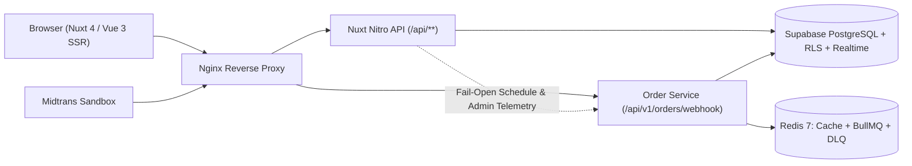

# ShelfStack

Aplikasi e-commerce single-vendor berbasis **Nuxt 4**, **Nitro**, **Supabase (PostgreSQL + Auth + Storage + Realtime)**, **Midtrans Sandbox**, dan worker mikroservis **Fastify + Redis 7 + BullMQ** (`@shelfstack/order-service`). Dirancang mengikuti estetika **Gallery Modernist** (`DESIGN.md`) dengan integritas transaksional di level database, pemisahan state pesanan dan pembayaran, serta komponen modular (`<= 300` baris per berkas `.vue`).

> Sumber kebenaran dokumentasi: [docs/README.md](docs/README.md), [docs/PROGRESS.md](docs/PROGRESS.md), [docs/BACKLOG.md](docs/BACKLOG.md), dan [DESIGN.md](DESIGN.md).

## Arsitektur Sistem



## Kapabilitas Utama

### Etalase Pelanggan (Storefront)

- **Katalog & Pencarian Sinkron URL**: Filter kategori, rute cantik per kategori (`/c/[slug]`), rentang harga, penyortiran, badge ketersediaan stok aktual, dan detail produk SEO-friendly (`/katalog`, `/product/[id]`).
- **Keranjang, Voucher, Koin Loyalitas & Ongkir**: Keranjang persisten (`Pinia`), klaim voucher/promo (`/promos`), penukaran koin loyalitas (`1 Koin = Rp 1`), dan 4 opsi kurir bertingkat dengan Bebas Ongkir otomatis untuk subtotal `>= Rp 500.000`.
- **Checkout Atomik & Midtrans Snap**: RPC PostgreSQL `create_order()` mengunci baris produk secara deterministik (`ORDER BY id FOR UPDATE`), memvalidasi harga/kupon/koin di sisi server, dan memproses pembayaran via Midtrans Snap Sandbox.
- **Pelacakan Realtime, Retur (RMA), Ulasan & Live Chat**: Linimasa status pesanan dan resi kurir (`/orders/[id]`, `/tracking`), pengajuan komplain/retur beserta bukti foto (`/returns`), ulasan terverifikasi pasca pesanan selesai, pusat notifikasi realtime, serta widget Live Chat dua arah dengan tim CS.

### Akun Demo Evaluasi Portofolio (1-Klik di `/auth/login`)

Tersedia pemilih kredensial instan 1-klik di halaman login publik tanpa perlu mengetik manual:

| Peran              | Alamat Email                     | Kata Sandi     | Lingkup Hak Akses                                                                                                                    |
| :----------------- | :------------------------------- | :------------- | :----------------------------------------------------------------------------------------------------------------------------------- |
| **Demo Pelanggan** | `demo-customer@shelfstack.local` | `Password123!` | Etalase publik, keranjang belanja, checkout Snap Midtrans, pelacakan pesanan, riwayat ulasan, wishlist, dan komplain retur           |
| **Demo Admin Ops** | `demo-admin@shelfstack.local`    | `Password123!` | Panel operasional `/admin`, dashboard KPI, transisi status pesanan, refund, audit log, inventaris & stok, kupon, dan inbox Live Chat |

### Telemetri & Observabilitas Multi-Layanan

- `GET /api/health` : Liveness probe proses Nitro (status service, uptime, timestamp, dan SemVer `version.json`).
- `GET /api/ready` : Readiness probe multi-layanan (konektivitas Supabase PostgreSQL, Redis cache, dan Fastify `@shelfstack/order-service`).

### Ruang Kerja Operasional Admin (`/admin`)

- **Dashboard Eksekutif & Analitik**: Ringkasan omzet bulanan, pesanan tertunda, peringatan stok kritis (`< 5`), dan mutasi transaksi terbaru.
- **Manajemen Pesanan, Refund & Telemetri BullMQ/DLQ**: Transisi status pesanan tervalidasi state-machine, alur refund bertahap (`create_refund_attempt` & `finalize_refund`), ekspor CSV, serta kartu pemantauan antrean kedaluwarsa BullMQ dan pemutaran ulang (_replay_) job Dead Letter Queue (`order-expiry-dlq`).
- **Inventaris, Kupon, Retur, Live Chat & Audit Log**: CRUD produk + _trash/restore_ (`deleted_at`), mutasi stok teraudit (`stock_movements`), manajemen kupon, pemrosesan tiket retur, inbox Live Chat multi-pelanggan, dan `activity_logs` lengkap.

## Sorotan Rekayasa Perangkat Lunak

1. **Integritas Transaksional PostgreSQL**: Seluruh mutasi stok, kuota kupon (`coupon_usages` dengan _soft delete_ `deleted_at`), dan saldo koin (`user_coins` + `coin_transactions`) dieksekusi secara atomik di dalam fungsi PL/pgSQL (`create_order`, `cancel_order`, `handle_payment_webhook`, `transition_order_status`, `finalize_refund`).
2. **State Machine Pesanan & Pembayaran Terpisah**: Trigger database `enforce_order_status_state_machine` memblokir perubahan status sembarangan di luar RPC resmi (`app.order_transition_source`).
3. **Antrean Kedaluwarsa BullMQ + Dead Letter Queue (DLQ)**: Checkout mendaftarkan delayed job per pesanan (`expire-order-<uuid>`) secara _fail-open_ ke `@shelfstack/order-service`, didukung _repeatable reconciliation sweep_ setiap 5 menit, _exponential backoff retry_ (`3` percobaan), dan eskalasi ke `order-expiry-dlq`.
4. **Primitif UI Mandiri & Standar Web Modern**: 16 primitif bebas pustaka komponen berat di `app/components/ui/`, pemuatan font `DM Sans` via `preconnect` tanpa rantai `@import` CSS, `fetchpriority="high"` terarah pada citra utama LCP, landmark `<search>`, _skip link_ keyboard, serta dukungan `prefers-reduced-motion`.

## Indeks Architecture Decision Records (ADR)

- [ADR-001: Nuxt 4 + Supabase Fullstack Topology](docs/ADR/001-nuxt-supabase.md)
- [ADR-002: Feature-Sliced Design Lite (`app/features/`)](docs/ADR/002-fsd-lite.md)
- [ADR-003: Integer Cents Pricing & Server-Authoritative Checkout RPC](docs/ADR/003-price-cents-rpc.md)
- [ADR-004: Single Supabase Project & Strict RLS Governance](docs/ADR/004-single-supabase-project.md)
- [ADR-005: Order State & Payment State Separation](docs/ADR/005-order-state-payment-state-separation.md)

## Persiapan Lokal (Quickstart 5 Menit)

> Repositori ini menggunakan **pnpm** secara eksklusif (`pnpm@11.5.3`). Jangan gunakan `npm`, `npx`, `yarn`, atau `bun`.

1. Salin berkas variabel lingkungan dari `.env.example` menjadi `.env`, lalu lengkapi kredensial Supabase, Midtrans Sandbox, dan `INTERNAL_SERVICE_KEY`.
2. Instal seluruh dependensi workspace:
   ```bash
   pnpm install --frozen-lockfile
   ```
3. Terapkan migrasi dan data awal (menghasilkan 5 kategori kanonik, produk kurasi, voucher, pesanan 5 status, ulasan, komplain retur, dan akun demo sesuai `supabase/seed.sql`):
   ```bash
   # Untuk project Supabase Cloud yang terhubung:
   pnpm db:seed

   # Atau untuk stack lokal Supabase Docker:
   pnpm db:seed:local
   ```
4. Jalankan server pengembangan Nuxt:
   ```bash
   pnpm dev
   ```
5. _(Opsional)_ Jalankan Redis dan mikroservis `@shelfstack/order-service` untuk menguji webhook terisolasi serta worker BullMQ/DLQ:
   ```bash
   docker compose -f docker-compose.dev.yml up -d
   pnpm --filter @shelfstack/order-service dev
   ```

## Perintah Verifikasi & Pengujian

| Perintah                                            | Deskripsi                                                           |
| :-------------------------------------------------- | :------------------------------------------------------------------ |
| `pnpm dev`                                          | Menjalankan server pengembangan Nuxt lokal                          |
| `pnpm db:seed`                                      | Menjalankan SQL seeder idempoten ke remote database Supabase Cloud  |
| `pnpm db:seed:local`                                | Menjalankan SQL seeder idempoten ke lokal Supabase Docker           |
| `pnpm lint`                                         | Pemeriksaan statis ESLint pada aplikasi utama dan server            |
| `pnpm typecheck`                                    | Pemeriksaan tipe penuh via `nuxi typecheck` (`app` + `server`)      |
| `pnpm --filter @shelfstack/order-service typecheck` | Pemeriksaan tipe TypeScript pada mikroservis `order-service`        |
| `pnpm exec vitest run`                              | Menjalankan seluruh unit test Nuxt sekali jalan (bukan watch mode)  |
| `pnpm --filter @shelfstack/order-service test`      | Menjalankan unit test Fastify, BullMQ, dan DLQ pada `order-service` |
| `pnpm test:e2e`                                     | Menjalankan skenario end-to-end Playwright (`tests/e2e/`)           |
| `pnpm build`                                        | Membangun bundel produksi Nuxt + Nitro                              |

> Pipeline CI di [.github/workflows/ci.yml](.github/workflows/ci.yml) memvalidasi `lint -> typecheck -> build -> vitest -> docker compose config` pada setiap push dan Pull Request.
