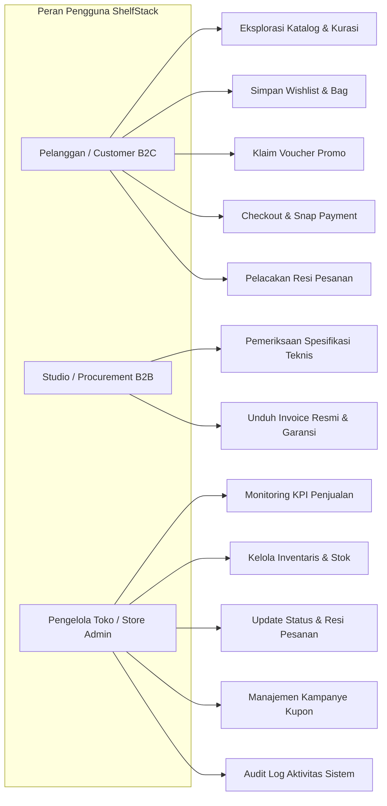
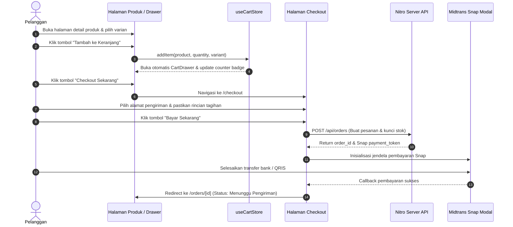
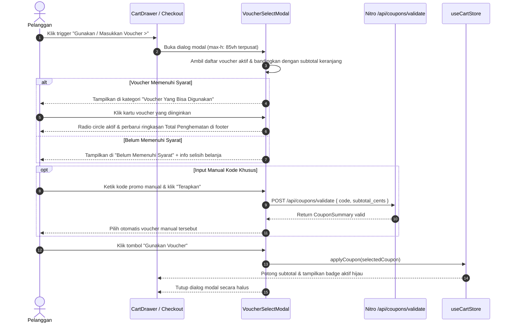
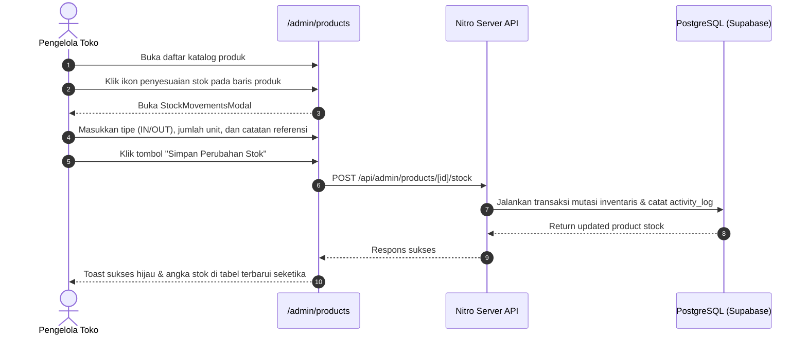
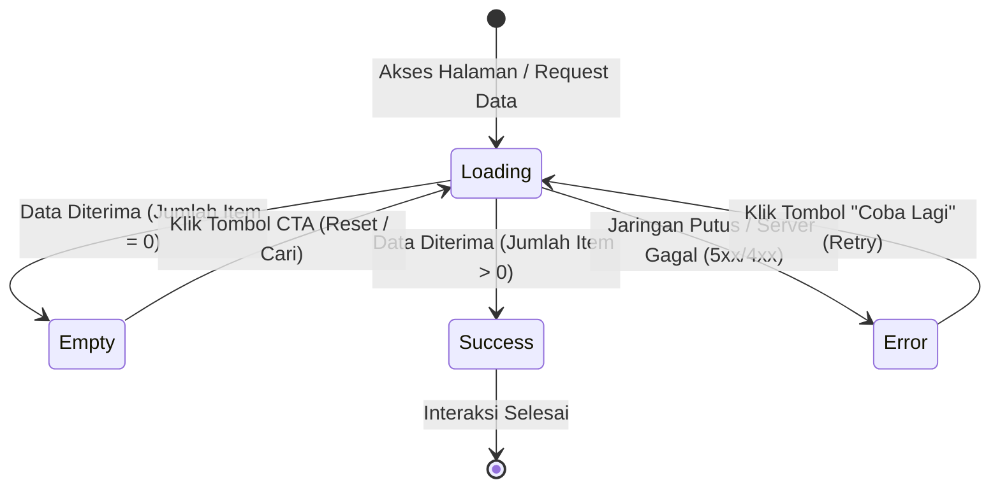

# ShelfStack UX Specification (UX-SPEC)

> **Document Status:** Official Reference  
> **Version:** 1.0.0 (October 2026)  
> **Author:** AA (Full-Stack Engineer & Tech Lead Pair)  
> **Target Audience:** Engineering, Product, QA, and Design

---

## 1. Executive Summary & Requirement Classification

Dokumen ini mendefinisikan spesifikasi pengalaman pengguna (UX Specification) untuk platform e-commerce kurasi **ShelfStack**. Seluruh spesifikasi disusun berdasarkan arsitektur aplikasi riil (Nuxt 4, Vue 3, Tailwind CSS, Supabase, dan Midtrans) serta Design System **Gallery Modernist** aktif.

### 1.1 Persyaratan Terkonfirmasi (Confirmed Requirements)

- **Model Bisnis**: Single-Vendor Curated Store. Seluruh inventaris dikelola langsung oleh ShelfStack dari gudang kurasi resmi.
- **Mata Uang & Format**: Indonesian Rupiah (IDR / Rp) dengan pemformatan angka tabular (`tabular-nums`) tanpa spasi antara simbol dan angka (`Rp1.499.000` atau `Rp 1.499.000`).
- **Pustaka Komponen**: Menggunakan pustaka atomik mandiri `app/components/ui/Ui*.vue` (`UiButton`, `UiInput`, `UiSelect`, `UiModal`, `UiCard`, `UiBadge`, `UiAlert`, `UiEmptyState`, `UiTabs`, `UiTooltip`, `UiToastHost`, `UiConfirmHost`). Paket pihak ketiga `primevue` tidak digunakan; hanya `primeicons` yang dipakai untuk glif ikonografi.
- **Otoritas Data**: PostgreSQL Supabase berotoritas mutlak atas inventaris, kalkulasi harga, status kupon, dan state mesin pembayaran. Sisi klien (frontend) tidak pernah menjadi penentu keabsahan harga atau ketersediaan stok.
- **Gerbang Pembayaran**: Integrasi Midtrans Snap Sandbox dengan dukungan QRIS, Virtual Account, dan Kartu Kredit, disertai rekonsiliasi status via webhook callback server.

### 1.2 Asumsi Kerja (Working Assumptions)

- **Jangkauan Logistik**: Pengiriman saat ini berfokus pada rute domestik Indonesia dengan opsi kurir standar (JNE, SiCepat, J&T).
- **Format Akun**: Autentikasi utama menggunakan email dan kata sandi dengan verifikasi peran berbasis tabel `profiles` (`role = 'admin'` atau `'customer'`).
- **Perilaku Sesi Tamu (Guest Checkout)**: Pengguna dapat menelusuri katalog, menambahkan item ke keranjang belanja, serta mengklaim kupon secara anonim. Pembuatan akun atau login diwajibkan saat mencapai tahapan finalisasi pembayaran di checkout.

---

## 2. Peran Pengguna & Tugas Utama (User Roles & Top Tasks)



### 2.1 Persona 1: The Discerning Professional (Customer B2C)

- **Profil**: Pengembang perangkat lunak, arsitek digital, dan kreator profesional (usia 22 sampai 40 tahun) yang membangun ruang kerja estetik dan fungsional.
- **Tugas Utama (Top Tasks)**:
  1. Menemukan produk kurasi spesifik menggunakan bilah pencarian atau filter kategori di katalog.
  2. Memeriksa ketersediaan stok, konfigurasi varian (warna/material), dan foto detail produk beresolusi tinggi.
  3. Memasukkan barang ke keranjang samping (Cart Drawer) dan mengatur kuantitas barang.
  4. Membuka modal pemilih kupon untuk mendapatkan diskon transaksi optimal.
  5. Menyelesaikan checkout dengan alamat tersimpan dan membayar instan via Midtrans Snap.
  6. Memantau progres paket pesanan hingga sampai di tujuan.

### 2.2 Persona 2: Studio / Corporate Procurement (Buyer B2B)

- **Profil**: Manajer operasional studio kreatif atau startup yang membeli perangkat kerja untuk workstation tim.
- **Tugas Utama (Top Tasks)**:
  1. Memverifikasi spesifikasi teknis mendalam per kategori (dimensi, konektivitas, daya tahan).
  2. Memeriksa keabsahan garansi resmi dan transparansi biaya per unit.
  3. Mengunduh lembar invoice digital resmi pasca pembayaran berhasil.

### 2.3 Persona 3: Store Administrator (Internal Operations)

- **Profil**: Tim pengelola operasional dan staf gudang ShelfStack.
- **Tugas Utama (Top Tasks)**:
  1. Memantau kesehatan transaksi toko di Dashboard KPI (omzet, pesanan masuk, stok menipis).
  2. Menerbitkan, mengedit, atau mengarsipkan produk secara soft-delete.
  3. Memasukkan mutasi stok masuk/keluar dan memantau riwayat inventaris.
  4. Mengonfirmasi pesanan, memperbarui status pengiriman, dan menginput nomor resi ekspedisi.
  5. Menerbitkan dan mengontrol kuota voucher promo.
  6. Menginspeksi rekaman audit log pengguna untuk transparansi data.

---

## 3. Arsitektur Informasi & Navigasi (Information Architecture)

### 3.1 Peta Situs & Struktur Rute (Sitemap)

```text
ShelfStack Platform Root
├── Storefront Layer (Layout: default.vue)
│   ├── / (Homepage / Beranda)
│   ├── /katalog (Katalog Produk & Filter Multi-Faset)
│   ├── /product/[id] (Halaman Detail Produk / PDP)
│   ├── /cart (Halaman Keranjang Belanja Penuh)
│   ├── /checkout (Pemeriksaan & Finalisasi Transaksi)
│   ├── /orders (Daftar Riwayat Pesanan Pelanggan)
│   ├── /orders/[id] (Detail Pesanan, Invoice, & Status Pembayaran)
│   ├── /tracking (Pelacakan Cepat Pengiriman Paket)
│   ├── /promos (Pusat Voucher Promo & Penawaran Belanja)
│   ├── /wishlist (Daftar Produk Favorit Tersimpan)
│   └── /notifications (Pusat Notifikasi Status Akun & Transaksi)
│
├── Auth Layer (Layout: default.vue / auth-card)
│   ├── /auth/login (Masuk Akun Pengguna)
│   ├── /auth/register (Pendaftaran Akun Baru)
│   ├── /auth/forgot-password (Permintaan Reset Sandi)
│   └── /auth/reset-password (Input Kata Sandi Baru)
│
└── Admin Workspace Layer (Layout: admin.vue, Guard: admin.ts)
    ├── /admin (Executive Dashboard & Bento KPI)
    ├── /admin/orders (Kelola & Filter Pesanan Toko)
    ├── /admin/orders/[id] (Detail Transaksi, Aksi Status, & Log)
    ├── /admin/products (Kelola Katalog Produk & Manajemen Stok)
    ├── /admin/coupons (Kelola Kupon Promo, Kuota, & Masa Berlaku)
    └── /admin/activities (Audit Trail & Log Aktivitas Sistem)
```

### 3.2 Pola Navigasi Storefront

- **Floating Stadium Navbar (`AppNavbar.vue`)**:
  - Posisi tetap (_sticky top-0_) mengambang di atas kanvas dengan material _frosted glass_ (`bg-brand-canvas-soft/90 backdrop-blur-xl border border-brand-hair`).
  - Berisi identitas merek (`AppLogo.vue`), tautan navigasi utama (Semua Produk, Tech & Gadget, Rumah & Dapur, Pakaian, Promo), bilah pencarian cepat, lonceng notifikasi, ikon wishlist berpenghitung badge, dan pemicu Cart Drawer.
- **Global Slide-over Cart Drawer (`CartDrawer.vue`)**:
  - Panel samping kanan yang muncul otomatis saat produk ditambahkan atau saat ikon tas belanja ditekan.
  - Memuat daftar item, pengatur kuantitas, kalkulator kupon ringkas, jaminan keamanan Midtrans, dan tombol CTA "Checkout Sekarang".
- **Modernist Plinth Footer (`AppFooter.vue`)**:
  - Panel penutup bawah berlatar kontras gelap (`bg-brand-ink text-white`) dengan radius lengkung atas (`rounded-t-card`).
  - Berisi identitas kurasi, panduan departemen, informasi garansi, dan indikator status sistem aktif (_live telemetry beacon_).

### 3.3 Pola Navigasi Admin Workspace

- **Desktop Sidebar (`admin.vue`)**:
  - Kolom samping statis selebar 64 unit (`w-64 border-r border-brand-hair bg-brand-canvas-soft`) dengan tautan navigasi bento: Dashboard, Kelola Pesanan, Kelola Produk, Kelola Voucher, dan Activity Log.
  - Tautan aktif ditandai dengan latar hitam kontras tinggi (`bg-brand-ink text-white shadow-whisper`).
- **Mobile Admin Drawer**:
  - Tombol hamburger pada layar kecil yang membuka drawer navigasi vertikal penuh tanpa menghalangi konten kerja tabel.

---

## 4. Hierarki Halaman & Aksi Pengguna (Page Hierarchy & Actions)

| Halaman                                 | Hierarki Konten                                                                                                                 | Aksi Utama (Primary Action)               | Aksi Sekunder (Secondary Action)                           |
| :-------------------------------------- | :------------------------------------------------------------------------------------------------------------------------------ | :---------------------------------------- | :--------------------------------------------------------- |
| **Beranda (`/`)**                       | Hero split showcase, ribbon kategori kurasi, flash deals terbatas, produk terpopuler, ulasan pembeli, dan garansi resmi.        | "Jelajahi Koleksi" (CTA Hero)             | Klik kategori kurasi, Simpan wishlist pada kartu produk    |
| **Katalog (`/katalog`)**                | Bilah filter samping (kategori, rentang harga, ketersediaan stok), toolbar pengurutan, grid kartu produk, pagination/counter.   | Filter & Urutkan Produk                   | Klik kartu produk, Simpan produk ke wishlist               |
| **Detail Produk (`/product/[id]`)**     | Galeri multi-gambar, nama produk, status stok, harga, konfigurator warna/material, spesifikasi teknis dinamis, jaminan garansi. | "Tambah ke Keranjang" (Electric Blue CTA) | Toggle wishlist, ubah varian, buka galeri foto penuh       |
| **Keranjang Drawer (`CartDrawer.vue`)** | Daftar item belanja, stepper kuantitas, pemicu modal voucher, ringkasan subtotal, dan diskon.                                   | "Checkout Sekarang" (Primary Ink CTA)     | Ubah kuantitas `[ - 1 + ]`, hapus item, buka modal voucher |
| **Pusat Promo (`/promos`)**             | Banner promosi animasi, filter kategori voucher, kartu tiket voucher, tombol salin kode, dan modal syarat ketentuan.            | "Gunakan di Keranjang" / "Salin Kode"     | Buka modal "Syarat & Ketentuan" voucher                    |
| **Checkout (`/checkout`)**              | Pemilih alamat tersimpan / input alamat baru, kurir pengiriman, catatan pesanan, input voucher, dan rincian tagihan.            | "Bayar Sekarang" (Pemicu Midtrans Snap)   | Ubah alamat tujuan, ubah voucher promo                     |
| **Detail Pesanan (`/orders/[id]`)**     | Banner status pembayaran, timeline pelacakan ekspedisi, rincian barang pesanan, rincian tagihan, nomor resi.                    | "Bayar Tagihan" (jika status Pending)     | "Batalkan Pesanan", "Unduh Invoice PDF"                    |
| **Admin Produk (`/admin/products`)**    | Toolbar pencarian & filter kategori, tombol tambah produk, tabel katalog produk, modal form produk, modal stok.                 | "Tambah Produk Baru" (Primary Button)     | Edit produk, sesuaikan stok masuk/keluar, hapus produk     |
| **Admin Pesanan (`/admin/orders`)**     | Kartu ringkasan status pesanan, filter rentang tanggal, tabel pesanan, aksi cepat pembaruan status pengiriman.                  | "Kirim Pesanan" / "Input Resi"            | Filter status transaksi, lihat rincian pesanan             |
| **Admin Kupon (`/admin/coupons`)**      | 4 Kartu KPI Bento, tabel voucher promo, switch aktif/nonaktif, modal terbit kupon baru.                                         | "Buat Voucher Baru"                       | Toggle status aktif, edit kuota, soft-delete kupon         |

---

## 5. Alur Pengguna Utama (Key User Flows)

### 5.1 Alur 1: Penelusuran Produk Menuju Pembayaran (Discovery to Purchase)



### 5.2 Alur 2: Pemilihan & Penerapan Voucher Promo (Voucher Selection Flow)



### 5.3 Alur 3: Manajemen Produk & Mutasi Inventaris oleh Admin



---

## 6. Validasi Formulir & UX Input (Form Validation Rules)

### 6.1 Prinsip Desain Input

- **Non-Destructive Recovery**: Ketika validasi gagal, sistem tidak pernah menghapus data yang telah diinput pengguna. Kolom input yang bermasalah tetap mempertahankan nilainya dan mendapatkan fokus (_cursor autofocus_).
- **Inline Contextual Errors**: Pesan galat ditampilkan tepat di bawah bidang input bersangkutan dengan teks merah semantik (`text-brand-danger`) dan garis tepi merah (`border-brand-danger`), bukan sekadar ringkasan error di puncak halaman.
- **Sanitasi Data Otomatis**: Input kode voucher otomatis dibersihkan dari spasi liar dan dikonversi menjadi huruf kapital (_uppercase_). Input kuantitas otomatis mengabaikan karakter non-numerik.

### 6.2 Matriks Validasi Formulir Utama

| Formulir            | Bidang Input    | Aturan Validasi (Zod Schema)                                                | Umpan Balik Galat (Error Message)                  |
| :------------------ | :-------------- | :-------------------------------------------------------------------------- | :------------------------------------------------- |
| **Auth Login**      | Email           | Wajib diisi, format email standar RFC 5322.                                 | "Format alamat email tidak valid."                 |
| **Auth Login**      | Password        | Wajib diisi, minimal 8 karakter.                                            | "Kata sandi minimal terdiri dari 8 karakter."      |
| **Alamat Checkout** | Nama Penerima   | Teks non-kosong, minimal 3 karakter.                                        | "Nama penerima wajib diisi lengkap."               |
| **Alamat Checkout** | Nomor Telepon   | Format angka seluler Indonesia (`08...` atau `+62...`), 10 sampai 14 digit. | "Nomor telepon tidak valid."                       |
| **Alamat Checkout** | Alamat Lengkap  | Teks rinci jalan/nomor rumah, minimal 10 karakter.                          | "Alamat pengiriman terlalu singkat."               |
| **Alamat Checkout** | Kota / Kode Pos | Terpilih dari opsi terdaftar, kode pos 5 digit angka.                       | "Pilih kota dan kode pos tujuan yang sah."         |
| **Voucher Promo**   | Kode Kupon      | Format alfanumerik huruf besar 3 sampai 20 karakter.                        | "Kode voucher tidak valid atau telah kedaluwarsa." |
| **Admin Produk**    | Nama Produk     | Minimal 3 karakter, maksimal 120 karakter.                                  | "Nama produk wajib diisi antara 3-120 karakter."   |
| **Admin Produk**    | Harga (IDR)     | Angka riil lebih besar dari 0.                                              | "Harga produk harus bernilai lebih dari Rp 0."     |
| **Admin Produk**    | Stok Awal       | Bilangan bulat non-negatif (`check (stock >= 0)`).                          | "Kuantitas stok tidak boleh bernilai negatif."     |

---

## 7. Penanganan Status Sistem (System States)



### 7.1 Status Memuat (Loading States)

- **Komponen Kerangka (`UiSkeleton.vue`)**: Digunakan saat memuat daftar kartu produk di katalog, tabel admin, dan daftar voucher di modal. Menghindari lonjakan tata letak (_Cumulative Layout Shift / CLS < 0.1_).
- **Indikator Tombol Aksi**: Komponen `UiButton.vue` mematikan pointer dan memunculkan spinner kecil saat proses mutasi berlangsung (`:loading="true"`), mencegah klik berulang dari pengguna.

### 7.2 Status Kosong (Empty States - `UiEmptyState.vue`)

Setiap tampilan tanpa data wajib menyajikan panduan tindakan positif, tidak membiarkan layar menjadi kanvas putih mati:

- **Keranjang Kosong**: Ikon tas belanja (`pi-shopping-bag`), teks _"Keranjang Anda Masih Kosong"_, dan tombol CTA utama _"Mulai Belanja"_ yang mengarah ke `/katalog`.
- **Wishlist Kosong**: Ikon hati (`pi-heart`), teks _"Belum Ada Produk Impian"_, dan tombol CTA _"Jelajahi Koleksi"_.
- **Pencarian / Filter Katalog Nihil**: Ikon pencarian (`pi-search`), teks _"Produk Tidak Ditemukan"_, dan tombol _"Reset Filter"_ untuk mengembalikan state filter awal.
- **Daftar Pesanan Kosong**: Ikon riwayat (`pi-inbox`), teks _"Belum Ada Riwayat Transaksi"_, dan tombol _"Temukan Produk Pilihan"_.

### 7.3 Status Kesalahan (Error States)

- **Komponen Peringatan (`UiAlert.vue`)**: Digunakan untuk kesalahan berskala modul (seperti kegagalan memuat daftar voucher di modal atau kegagalan transaksi pembayaran). Disertai tombol tindakan _"Coba Lagi"_ (`retry`) tanpa memuat ulang seluruh halaman web.
- **Isolasi Galat Jaringan**: Kegagalan konektivitas ditangkap dalam blok `try/catch` dan ditampilkan melalui toast danger non-invasif tanpa memutus sesi aktif pengguna.

### 7.4 Status Keberhasilan (Success States)

- **Toast Notifikasi (`useUiToast` & `UiToastHost.vue`)**: Konfirmasi instan berwarna hijau semantik (`--brand-success-tint`) berdurasi 3000ms sampai 4000ms pada aksi penting (cth: "Produk berhasil ditambahkan ke keranjang", "Voucher berhasil diterapkan").
- **Konfirmasi Transaksional**: Mengarahkan pengguna langsung ke halaman invoice detail pesanan dengan visualisasi timeline status pengiriman yang jelas.

---

## 8. Perilaku Responsif & Ergonomi Sentuh (Responsive & Touch Ergonomics)

### 8.1 Standar Breakpoint Layar

Sistem tata letak mengikuti standar breakpoint Tailwind CSS:

- **Mobile (`< 640px`)**: Tata letak satu kolom vertikal, bilah navigasi bawah untuk drawer, kartu produk 2 kolom rapat dengan aspek rasio visual 1:1.
- **Tablet (`640px - 1023px`)**: Grid katalog 2 sampai 3 kolom, floating stadium navbar mulai beradaptasi horizontal.
- **Desktop (`>= 1024px`)**: Grid katalog 3 sampai 4 kolom, sidebar admin statis terbuka penuh, modal terpusat di tengah viewport (`sm:items-center sm:max-h-[85vh]`).

### 8.2 Ergonomi Sentuh Layar Sentuh (Touch Guidelines)

- **Target Sentuh Minimum**: Seluruh elemen interaktif pada layar mobile (tombol kuantitas, ikon wishlist, tombol hapus, dan pemicu drawer) memiliki area ketukan minimum **44×44px** (`min-h-[44px] min-w-[44px]` atau padding kompensasi).
- **Pencegahan Scroll Chaining**: Seluruh modal dialog dan drawer menerapkan penguncian scroll pada body dokumen (`lockBodyScroll`) saat terbuka untuk mencegah pergeseran latar belakang web.
- **Navigasi Jempol Ramah (Thumb Zone)**: Tombol aksi krusial pada Cart Drawer dan Checkout diletakkan di sisi bawah layar yang mudah dijangkau satu tangan.

---

## 9. Aksesibilitas & Standar Inklusif (Accessibility / a11y)

### 9.1 Rasio Kontras Warna (WCAG 2.1 AA)

- Seluruh teks isi (body text) menggunakan rasio kontras minimal **4.5:1** terhadap latar belakang kanvas.
- Teks judul besar dan elemen grafis penting memenuhi rasio kontras minimal **3:1**.
- Teks status pada badge dan alert menggunakan ramp warna bertingkat yang lebih pekat (`--brand-success-text`, `--brand-warning-text`, `--brand-danger-text`) di atas latar tint untuk memastikan keterbacaan optimal.

### 9.2 Navigasi Keyboard & Perangkap Fokus (Keyboard Navigation)

- Seluruh dialog modal (`UiModal.vue`) mengimplementasikan _focus trap_ saat terbuka: tombol `Tab` dan `Shift + Tab` berputar hanya di dalam elemen fokus modal.
- Tombol `Escape` secara default menutup modal dan mengembalikan fokus keyboard ke elemen pemicu sebelumnya (_restore focus_).
- Indikator cincin fokus yang tegas (`focus-visible:ring-2 focus-visible:ring-brand-accent focus-visible:outline-none`) pada setiap tautan, input, dan tombol.

### 9.3 Pembaca Layar (Screen Readers & ARIA)

- Tombol yang hanya memuat ikon (seperti tombol hapus keranjang atau silang penutup modal) wajib memiliki atribut `aria-label` deskriptif (misal: `aria-label="Hapus item dari keranjang"`).
- Struktur hierarki heading halaman (`h1` sampai `h4`) tersusun teratur tanpa melompati tingkatan hierarki dokumen.

### 9.4 Aturan Bahasa & Anti-Slop

- **Tanpa Tanda Em Dash**: Teks antarmuka, label status, dan petunjuk sistem dilarang menggunakan karakter em dash. Seluruh pemisah kalimat menggunakan tanda baca standar yang ramah lokalisasi (titik dua, koma, titik, atau tanda kurung).
- **Label Nilai Nyata**: Dilarang menampilkan angka atau klaim palsu yang tidak didukung data nyata dari database.
