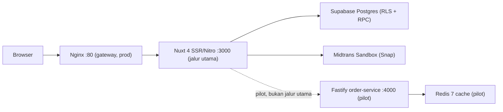

# Gambaran Arsitektur ShelfStack

Pola frontend mengikuti FSD-lite (lihat `docs/ARCHITECTURE.md` dan `docs/ADR/002-fsd-lite.md`): `app/pages/` hanya routing, `app/features/<nama>/` memuat komponen, composable, store, dan repository per fitur, `app/components/` hanya untuk komponen global. Keputusan stack utama tercatat di `docs/ADR/001-nuxt-supabase.md` (Nuxt 4 SSR + Supabase) dan `docs/ADR/004-single-supabase-project.md` (satu project Supabase Cloud).

## Jalur utama

Browser mengirim request ke Nginx pada port 80, lalu diteruskan ke Nuxt 4 SSR/Nitro pada port 3000. Nama service dan port ini terbaca di `deploy/docker-compose.prod.yml` (service `gateway` dengan `80:80`, service `frontend` dengan expose `3000`). Pada `docker-compose.yml` dev tidak ada service Nginx, hanya `frontend` (`3000:3000`), `order-service`, dan `redis`.

Nuxt adalah jalur utama API. Endpoint Nitro yang terverifikasi via `server/api/**/*.ts` antara lain `server/api/health.get.ts`, `server/api/ready.get.ts`, `server/api/orders/index.ts`, `server/api/orders/[id]/cancel.post.ts`, `server/api/orders/[id]/refund.post.ts`, `server/api/orders/[id]/payment-token.post.ts`, `server/api/orders/[id]/check-payment-status.post.ts`, `server/api/orders/[id]/status.put.ts`, dan `server/api/midtrans/notification.post.ts`.

Postgres diakses dengan RLS dan RPC. Fungsi RPC yang terverifikasi di `supabase/migrations` adalah `create_order` (`20261001000001_orders_and_checkout_rpc.sql`, diperkeras di `20261009000001_concurrency_hardening_and_catalog_fts.sql` dan `20261104000001_checkout_idempotency_keys.sql`), `handle_payment_webhook` (pertama di `20261009000001_concurrency_hardening_and_catalog_fts.sql`), dan `transition_order_status` (pertama di `20261105000001_order_state_machine_transition_rpc.sql`). Uang disimpan dalam cents dan checkout dihitung di server, sesuai `docs/ADR/003-price-cents-rpc.md`.

Pembayaran memakai Midtrans Sandbox (Snap). Bukti: `nuxt.config.ts` memakai default `https://app.sandbox.midtrans.com/snap/v1/transactions` dan `snap.js` Sandbox, serta `server/utils/midtrans.ts` memanggil API Sandbox `https://api.sandbox.midtrans.com/v2`.

## State client

Modul Pinia aktif via `@pinia/nuxt` di `nuxt.config.ts`. Store Pinia yang terverifikasi: `app/features/cart/stores/cart.ts` (`useCartStore`, persist ke `localStorage` dengan kunci `shelfstack-cart`). Auth diakses via composable `app/features/auth/composables/useAuth.ts` (`useAuth`), bukan Pinia store (tidak ada `app/features/auth/stores/`).

Status order di client diperbarui lewat Supabase Realtime channel. Bukti: `app/pages/orders/[id].vue` memakai `.channel(`order-realtime-${orderId}`)`, `app/pages/orders/index.vue` memakai `.channel(`orders-user-${user.value.id}`)`, dan `app/features/activities/composables/useActivities.ts` memakai `.channel('public:activity_logs')`.

## Pilot (bukan jalur utama)

Service `order-service` (Fastify, port 4000) dan `redis` (image `redis:7-alpine`) didefinisikan di `docker-compose.yml` dan `deploy/docker-compose.prod.yml`. Kode pilot ada di `services/order-service/src` (`app.ts`, `server.ts`, `config.ts`, folder `routes/`, `services/`, `cache/`, `plugins/`, `utils/`, `workers/`). Label eksplisit: pilot, bukan jalur utama. BullMQ: TODO (belum diimplementasi). Bukti: tidak ada dependensi `bullmq` di `package.json`, dan `AGENTS.md` serta `README.md` menyatakan order-expiry masih direct sweep tanpa queue atau DLQ.

## Observability

Log server berbentuk JSON satu baris dengan `requestId` dan `correlationId`, mengikuti `docs/engineering/observability.md` (skema di bagian 2, alur tracing Nginx ke Nuxt ke Fastify di bagian 3). Liveness dibedakan dari readiness: `/api/health` (liveness, tanpa query DB) vs `/api/ready` (readiness, cek konektivitas database dengan timeout terbatas). File endpoint yang terverifikasi: `server/api/health.get.ts` dan `server/api/ready.get.ts` (plus alias `server/api/health/ready.get.ts`).

## CI

Urutan pipeline mengikuti `.github/workflows/ci.yml` dengan nama job yang benar: `code-quality` (lint dengan `pnpm lint`, typecheck root dengan `pnpm typecheck`, typecheck order-service, build dengan `pnpm build`), lalu `test-suites` (Vitest root dengan `pnpm vitest run`, test order-service), lalu `infrastructure-validation` (validasi `docker compose config` untuk dev dan prod), lalu `e2e-playwright` (install Chromium lalu `pnpm test:e2e`).
