# Cetak Biru Rekayasa & Rencana Peningkatan Lanjutan ShelfStack

Dokumen ini mendokumentasikan spesifikasi teknis, arsitektur, dan peta jalan implementasi untuk **fitur-fitur penyempurnaan mendalam (extended enhancements)** pasca-v1.0 pada platform e-commerce ShelfStack.

Tujuan dokumen ini adalah memberikan panduan konkret sebelum eksekusi kode, menjaga standar arsitektur FSD-lite, kepatuhan batas maksimal 300 baris per berkas, pengetikan ketat (zero `any`), dan pengujian otomatis tanpa regresi.

---

## 1. Peta Arsitektur 6 Klaster Peningkatan

```mermaid
flowchart TD
    subgraph K1["Klaster 1: Otomasi Email Transaksional Backend"]
        E1["Server Email Dispatcher: Resend / SMTP / Mock"]
        E2["Hook Event: order_placed, payment_success, order_shipped"]
        E3["Fail-Open Resilience & email_delivery_logs"]
    end

    subgraph K2["Klaster 2: Discovery & Live Omnibox Search"]
        S1["Endpoint Latensi Rendah /api/products/search-instant"]
        S2["Floating Autocomplete Popover di Navbar"]
        S3["Keyboard Navigation: ArrowUp, ArrowDown, Enter, Esc"]
    end

    subgraph K3["Klaster 3: Filter & Sortir Katalog Lanjutan"]
        F1["Price Range Input & Quick Chips Rupiah"]
        F2["Toggle In-Stock Only: Filter Stok Habis"]
        F3["Mode Tampilan Grid Card vs Compact List"]
    end

    subgraph K4["Klaster 4: Unifikasi Geometri Etalase"]
        G1["KatalogToolbar & Sisa Native Input ke UiInput"]
        G2["Keranjang & Drawer ke UiButton & UiCard"]
        G3["Form Checkout & Ringkasan Pembayaran ke Primitif Ui*"]
    end

    subgraph K5["Klaster 5: Customer Portal & Self-Service"]
        C1["Buku Kas Mutasi Koin Loyalitas /account/coins"]
        C2["Dompet Voucher Aktif & Kadaluarsa /account/vouchers"]
        C3["Alamat Pengiriman Utama: Default Auto-Select"]
    end

    subgraph K6["Klaster 6: CRM Admin & Security Rate Limiting"]
        A1["Panel Kelola Pelanggan /admin/users & LTV"]
        A2["Rate Limiting Token Bucket Endpoint Kritis"]
        A3["Security Headers Plugin: CSP, HSTS, X-Frame"]
    end

    K1 --> K2 --> K3 --> K4 --> K5 --> K6
```

---

## 2. Rincian Teknis per Klaster

### Klaster 1: Otomasi Email Transaksional Backend & Fail-Open Dispatcher

**Latar Belakang & Masalah:**
Template HTML email responsif (`shared/utils/email-templates.ts`) dan modal pratinjau live di panel admin sudah tersedia, namun belum terhubung ke siklus backend otomatis saat transaksi nyata terjadi.

**Spesifikasi Rekayasa:**

1. **Modul Pengirim Asinkron (`server/utils/email-dispatcher.ts`)**:
   - Multi-driver: Resend API / SMTP Transport untuk production, dan Console/Mock transport untuk development lokal (mencatat subjek dan konten tanpa melempar exception jika API key kosong).
   - Sifat non-blocking dan fail-open: Kegagalan jaringan email tidak boleh menggagalkan transaksi pesanan atau webhook database.
2. **Titik Integrasi Hook Pesanan**:
   - _Pemesanan Dibuat_: `server/api/orders/index.post.ts` memicu pengiriman email `order_placed`.
   - _Pembayaran Dikonfirmasi_: `server/api/midtrans/notification.post.ts` memicu email `payment_success`.
   - _Pengiriman Kurir_: `server/api/admin/orders/[id]/status.patch.ts` memicu email `order_shipped` lengkap dengan nomor resi kurir.
3. **Pencatatan Audit Pengiriman**:
   - Struktur data riwayat log pengiriman: `order_id`, `recipient_email`, `template_type`, `status` (`sent` atau `failed`), `provider_id`, `error_message`, dan `created_at`.
4. **Kriteria Penerimaan (Acceptance Criteria)**:
   - Unit test memverifikasi pemanggilan template yang tepat per status.
   - Simulasi timeout provider email membuktikan endpoint pesanan tetap mengembalikan respons sukses (HTTP 200/201).

---

### Klaster 2: Live Instant Search Omnibox di Navbar

**Latar Belakang & Masalah:**
Pencarian di `AppNavbar.vue` saat ini hanya melakukan pengalihan statis ke halaman katalog saat tombol Enter ditekan. Pengguna belum mendapatkan umpan balik langsung saat mengetik.

**Spesifikasi Rekayasa:**

1. **Endpoint Backend Ringan (`server/api/products/search-instant.get.ts`)**:
   - Menerima parameter `q` (minimal 2 karakter).
   - Menjalankan pencarian cepat dengan proyeksi kolom minimal: `id, name, slug, price_cents, image_url, category, stock`.
   - Mengembalikan maksimal 5 produk relevan dan 3 kategori rekomendasi dengan latensi target < 50ms.
2. **Komponen Floating Autocomplete Popover (`SearchAutocompletePopover.vue`)**:
   - Muncul di bawah bilah pencarian navbar dengan penundaan debounced 250ms.
   - Menampilkan kartu produk ringkas: gambar thumbnail, nama produk, harga format rupiah, dan status ketersediaan stok.
3. **Aksesibilitas & Navigasi Keyboard Penuh**:
   - Tombol panah `ArrowDown` dan `ArrowUp` untuk memindahkan fokus penyorotan item.
   - Tombol `Enter` pada item terpilih langsung membuka halaman produk terkait.
   - Tombol `Escape` atau klik di luar kontainer langsung menutup popover pencarian.
4. **Kriteria Penerimaan (Acceptance Criteria)**:
   - Pencarian tidak memicu request berulang saat mengetik cepat berkat debounce.
   - Navigasi keyboard teruji dan ramah screen reader (atribut ARIA `role="listbox"` dan `aria-expanded`).

---

### Klaster 3: Filter & Sortir Katalog Lanjutan

**Latar Belakang & Masalah:**
Katalog saat ini sudah memiliki filter kategori dan filter rating ulasan, tetapi belum menyediakan filter rentang harga dinamis dan filter ketersediaan stok instan.

**Spesifikasi Rekayasa:**

1. **Filter Rentang Harga Interaktif (`KatalogPriceRangeFilter.vue`)**:
   - Dua input teks angka terformat Rupiah untuk `min_price` dan `max_price`.
   - Tombol cepat (_Quick Chips_) untuk rentang harga populer:
     - Di bawah Rp 250.000
     - Rp 250.000 hingga Rp 1.000.000
     - Di atas Rp 1.000.000
   - Tersinkronisasi dengan URL query dan query parser database di `server/api/products/index.ts`.
2. **Filter Ketersediaan Stok (`In-Stock Only`)**:
   - Toggle switch "Hanya Tampilkan Produk Tersedia" untuk menyaring dan menyembunyikan produk yang berstatus stok habis (`stock <= 0`).
3. **Mode Tampilan Grid vs Compact List**:
   - Tombol beralih antara tampilan grid kartu produk visual (default) dan tampilan list horizontal kompak dengan spesifikasi teknis ringkas.
4. **Kriteria Penerimaan (Acceptance Criteria)**:
   - Melakukan filter rentang harga tidak menghilangkan parameter kategori atau rating yang sedang aktif.
   - URL browser dapat dibagikan (shareable URL) dan mempertahankan kondisi filter saat di-refresh.

---

### Klaster 4: Unifikasi Geometri Primitif Etalase (Known Gap)

**Latar Belakang & Masalah:**
Catatan resmi di `PROGRESS.md` menyatakan kontrol etalase publik (katalog, keranjang, checkout) sebagian masih menggunakan gaya elemen native ad-hoc dan belum memanfaatkan primitif resmi di `app/components/ui/` yang dipakai di panel admin.

**Spesifikasi Rekayasa:**

1. **Toolbar Katalog ([KatalogToolbar.vue](file:///d:/MAGANG/TALENAVI/FRONTEND/shelfstack/app/components/katalog/KatalogToolbar.vue))**:
   - Mengganti input native dengan `<UiInput>`.
   - Mengganti dropdown sortir dengan `<UiSelect>` dengan gaya konsisten.
   - Mengganti badge filter aktif dengan `<UiBadge>`.
2. **Keranjang Belanja ([app/pages/cart.vue](file:///d:/MAGANG/TALENAVI/FRONTEND/shelfstack/app/pages/cart.vue))**:
   - Menyeragamkan kartu ringkasan belanja menggunakan `<UiCard>`.
   - Menyelaraskan tombol aksi checkout dan kontrol penambahan kuantitas (`+` dan `-`) dengan token `<UiButton>`.
3. **Formulir Checkout ([app/pages/checkout.vue](file:///d:/MAGANG/TALENAVI/FRONTEND/shelfstack/app/pages/checkout.vue))**:
   - Memastikan seluruh input teks formulir checkout menggunakan `<UiInput>` dengan penanganan status error validasi yang seragam.
4. **Kriteria Penerimaan (Acceptance Criteria)**:
   - Desain sistem _Gallery Modernist_ seragam antara etalase dan admin.
   - Zero console error dan lolos seluruh asersi visual responsive Playwright.

---

### Klaster 5: Portal Pelanggan & Layanan Mandiri (Customer Self-Service)

**Latar Belakang & Masalah:**
Pelanggan saat ini dapat menukarkan koin dan kupon di checkout, namun belum memiliki halaman khusus untuk melihat riwayat mutasi koin loyalitas dan dompet voucher secara transparan.

**Spesifikasi Rekayasa:**

1. **Buku Kas Riwayat Koin Loyalitas (`/account/coins`)**:
   - Tabel mutasi koin transparan:
     - Koin masuk (+koin) dari pesanan selesai (`completed`).
     - Koin keluar (-koin) saat digunakan untuk potongan belanja di checkout.
     - Saldo koin aktif yang diperbarui secara reaktif.
2. **Dompet Voucher Pelanggan (`/account/vouchers`)**:
   - Menampilkan tiket voucher yang dimiliki pengguna: nilai potongan (persen atau rupiah), minimal transaksi, masa berlaku, dan tombol cepat "Gunakan di Keranjang".
   - Tab riwayat untuk voucher yang sudah digunakan atau kadaluarsa.
3. **Penanda Alamat Pengiriman Utama (Default Address)**:
   - Opsi "Jadikan Alamat Utama" pada formulir alamat pelanggan (`is_default: boolean`).
   - Alamat utama otomatis terpilih secara instan saat pengguna masuk ke halaman checkout.
4. **Kriteria Penerimaan (Acceptance Criteria)**:
   - Perubahan alamat utama secara atomik memperbarui record lain menjadi `is_default = false`.
   - Pengujian unit memvalidasi perhitungan saldo koin dan masa aktif voucher.

---

### Klaster 6: CRM Pelanggan Admin & Hardening Keamanan Server

**Latar Belakang & Masalah:**
Panel admin belum memiliki menu khusus untuk mengelola data pelanggan dan mengukur nilai belanja total (Customer Lifetime Value). Di sisi keamanan, endpoint sensitif belum diproteksi oleh rate limiter.

**Spesifikasi Rekayasa:**

1. **Manajemen Pelanggan Back-Office (`/admin/users`)**:
   - Daftar pelanggan terdaftar: Nama, email, tanggal bergabung, total transaksi pesanan, dan total nilai belanja riil (_Lifetime Value / LTV_).
   - Lencana status loyalitas: Pelanggan Baru, Pelanggan Aktif, Pelanggan VIP (> Rp 10.000.000).
   - Pencarian cepat pelanggan berdasarkan nama atau email.
2. **Rate Limiting Token Bucket Endpoint Kritis (`server/middleware/rate-limit.ts`)**:
   - Proteksi brute-force login (`POST /api/auth/login`): Maksimal 5 percobaan gagal per IP dalam 1 menit.
   - Proteksi spam pemesanan (`POST /api/orders`): Maksimal 10 pesanan per pengguna dalam 1 menit.
   - Proteksi DoS pencarian (`GET /api/products/search-instant`): Maksimal 30 request per IP dalam 1 menit.
   - Mengembalikan respons standar HTTP 429 _Too Many Requests_ dengan header `Retry-After`.
3. **Security Headers Nitro Plugin (`server/plugins/security-headers.ts`)**:
   - Pemasangan otomatis header HTTP pertahanan: `X-Content-Type-Options: nosniff`, `X-Frame-Options: SAMEORIGIN`, `Referrer-Policy: strict-origin-when-cross-origin`.
4. **Kriteria Penerimaan (Acceptance Criteria)**:
   - Percobaan request berlebih memicu respons 429 tanpa merusak sesi pengguna lain.
   - Endpoint admin users dilindungi otorisasi ketat `requireAdmin(event)`.

---

## 3. Matriks Kepatuhan Standar Rekayasa (Definition of Done)

Setiap implementasi pada klaster di atas wajib mematuhi ketentuan berikut:

1. **Batas Ukuran Komponen**: Seluruh berkas `.vue` dan `.ts` baru dan modifikasi wajib berada di bawah **300 baris kode**.
2. **Pengetikan Ketat (Strict Typing)**: Dilarang menggunakan tipe `any`. Seluruh input dan payload divalidasi dengan skema Zod.
3. **Higienitas Penulisan**: Bebas tanda em dash di seluruh teks antarmuka dan komentar kode.
4. **Quality Gates Mandatory**: Lolos `pnpm lint` (0 error), `pnpm typecheck` (EXIT 0), dan seluruh rangkaian `pnpm exec vitest run` sebelum membuka Pull Request.
5. **Git Protocol**: Format commit `<type>: [AA] <short description in English>` tanpa flag `--no-verify`.
